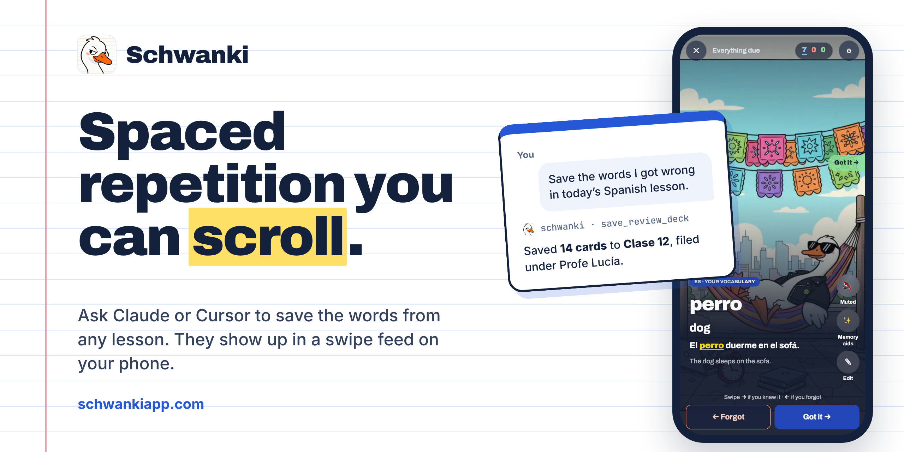
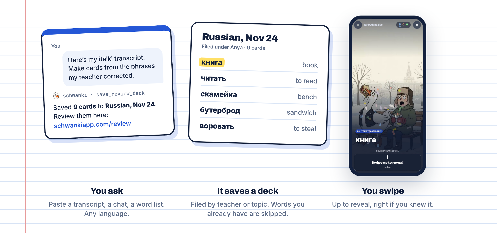
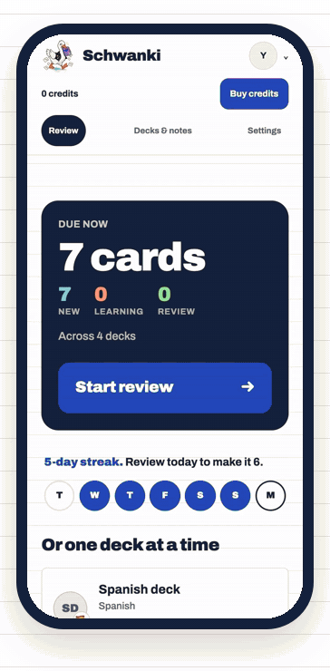

<p align="center">
  <a href="https://schwankiapp.com/?ref=github-plugins">
    
  </a>
</p>

<p align="center">
  <a href="https://claude.ai/directory/schwanki"></a>&nbsp;
  <a href="https://cursor.com/en/install-mcp?name=schwanki&config=eyJ1cmwiOiJodHRwczovL3NjaHdhbmtpYXBwLmNvbS9tY3AifQ=="></a>&nbsp;
  <a href="https://vscode.dev/redirect/mcp/install?name=schwanki&config=%7B%22type%22%3A%22http%22%2C%22url%22%3A%22https%3A%2F%2Fschwankiapp.com%2Fmcp%22%7D"></a>
</p>

<p align="center">
  <a href="https://schwankiapp.com/?ref=github-plugins"><b>schwankiapp.com</b></a>
  &nbsp;·&nbsp;
  <a href="https://play.google.com/store/apps/details?id=io.lasalida.schwanki&referrer=utm_source%3Dgithub-plugins">Android app</a>
  &nbsp;·&nbsp;
  <a href="https://schwankiapp.com/integrations/mcp?ref=github-plugins">Setup guide</a>
  &nbsp;·&nbsp;
  <a href="https://schwankiapp.com/support?ref=github-plugins">Support</a>
</p>

<br>

You just spent an hour in a lesson, a chat with a tutor, or a translation thread with your AI. The words you missed are sitting right there in the transcript. Tell your assistant to keep them, and Schwanki turns them into a deck you review the way you scroll Reels: one word per screen, swipe up to see it, right if you knew it, left if you forgot.

This repo holds Schwanki's official plugins for **Claude Code** and **Cursor**, and the public listing for Schwanki's MCP server, which works in Claude, ChatGPT, VS Code and any other app that speaks MCP.

## How it works

<p align="center">
  
</p>

Schwanki schedules every card with FSRS, the same spaced-repetition algorithm modern Anki uses, so each word comes back right before you'd forget it. You don't manage any of that. You open the app and scroll.

## Install

<details open>
<summary><b>Claude</b> (claude.ai, desktop and mobile)</summary>
<br>

Schwanki is in [Claude's connector directory](https://claude.ai/directory/schwanki). Open it, choose **Connect**, and sign in to Schwanki. Then ask Claude to save some words.

</details>

<details>
<summary><b>Claude Code</b></summary>
<br>

Install the plugin, which adds the MCP server and a `make-schwanki-deck` skill that knows how to pick words from a transcript:

```
/plugin marketplace add La-Salida/schwanki-plugins
/plugin install schwanki@schwanki
```

Or add only the server:

```
claude mcp add --transport http schwanki https://schwankiapp.com/mcp/claude
```

</details>

<details>
<summary><b>Cursor</b></summary>
<br>

Use the **Add to Cursor** button above, or add this to `~/.cursor/mcp.json`:

```json
{
  "mcpServers": {
    "schwanki": { "url": "https://schwankiapp.com/mcp" }
  }
}
```

</details>

<details>
<summary><b>VS Code</b></summary>
<br>

Use the **Add to VS Code** button above, or run **MCP: Add Server** from the command palette, pick **HTTP**, and paste `https://schwankiapp.com/mcp`.

</details>

<details>
<summary><b>ChatGPT, Perplexity, Le Chat, Grok and everything else</b></summary>
<br>

Add a custom connector (in ChatGPT, turn on developer mode first) with this URL:

```
https://schwankiapp.com/mcp
```

Per-app steps live on the [setup guide](https://schwankiapp.com/integrations/mcp?ref=github-plugins).

</details>

There's no API key. The first time a tool runs, your app opens Schwanki's sign-in page. Check the app's name, choose **Connect**, and you're done. No account yet? Signing in creates one for free.

## What it feels like



Every card is a full-screen scene with the word on top, and the Chaos Goose causing trouble somewhere in the picture. Swipe up to reveal the meaning and an example sentence. Swipe right if you knew it, left if you forgot.

Keep a run going and the goose notices. Finish the day's cards and you get a card worth sharing, plus your streak.

Decks you save from a chat sit next to everything else you study: Anki decks you import with their review history, class notes, whiteboard photos and Google Docs lessons.

Get the Android app on [Google Play](https://play.google.com/store/apps/details?id=io.lasalida.schwanki&referrer=utm_source%3Dgithub-plugins), or open [schwankiapp.com](https://schwankiapp.com/?ref=github-plugins) in any phone browser and add it to your home screen.

<a href="https://play.google.com/store/apps/details?id=io.lasalida.schwanki&referrer=utm_source%3Dgithub-plugins"></a>

<br clear="right">

## Tools

| Tool | What it does |
| --- | --- |
| `list_decks` | Lists your decks with their language, card count and how many cards are due now |
| `get_deck_cards` | Reads a deck's cards and your review progress on each, up to 200 per call |
| `save_review_deck` | Saves 1 to 24 cards in one language as a deck, filed under a teacher or topic, skipping cards you already have |

Connected apps can read your decks and add new ones. They can't edit or delete your decks, cards or review history.

## Things to ask

> Take this transcript from my italki Chinese lesson and save the 20 words I struggled with, filed under my teacher.

> Turn the words from this translation chat into cards filed under Señora Raquel, with an example sentence on each.

> Find the French words I keep forgetting and make me a new deck of short phrases that use them.

> I'm going to Tokyo next week. Make me a deck of the 15 phrases I'll actually need, with readings.

## Pictures, audio and video

Through `https://schwankiapp.com/mcp`, the save tool can also give cards a picture, audio or a short video in your Schwanki style. These use Schwanki AI credits (1 per picture or audio clip, 7 per video) and are made only when you ask for them.

## Links

[Website](https://schwankiapp.com/?ref=github-plugins) ·
[Android app](https://play.google.com/store/apps/details?id=io.lasalida.schwanki&referrer=utm_source%3Dgithub-plugins) ·
[Claude setup](https://schwankiapp.com/integrations/claude?ref=github-plugins) ·
[MCP setup](https://schwankiapp.com/integrations/mcp?ref=github-plugins) ·
[Anki alternative](https://schwankiapp.com/anki-alternative?ref=github-plugins) ·
[Pricing](https://schwankiapp.com/pricing?ref=github-plugins) ·
[Privacy](https://schwankiapp.com/privacy?ref=github-plugins) ·
[Terms](https://schwankiapp.com/terms?ref=github-plugins) ·
[Support](https://schwankiapp.com/support?ref=github-plugins)

<details>
<summary>For maintainers: MCP Registry</summary>
<br>

`server.json` is Schwanki's entry in the [MCP Registry](https://registry.modelcontextprotocol.io) as `io.github.La-Salida/schwanki`. To update it, bump `version` and run the **Publish to MCP Registry** workflow.

</details>

<br>

<p align="center">
  <a href="https://schwankiapp.com/?ref=github-plugins"></a>
  <br>
  <sub>Made by El Sueno LLC</sub>
</p>
